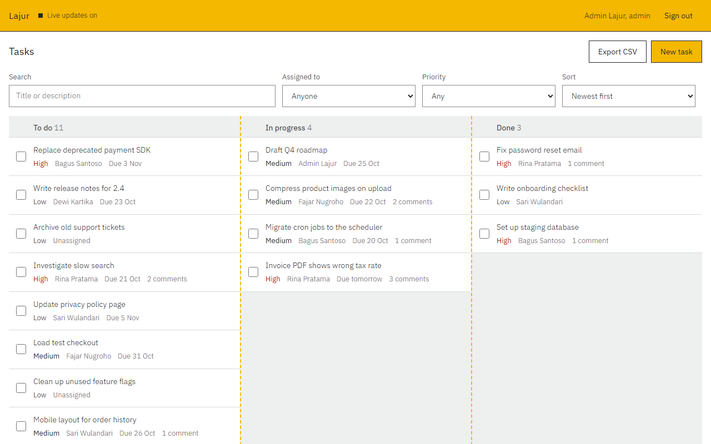
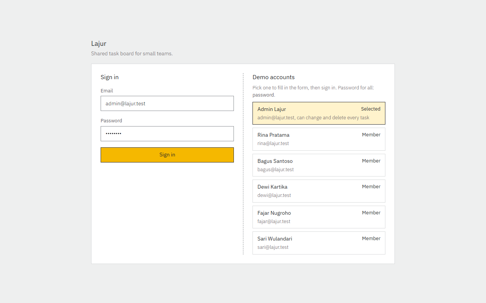
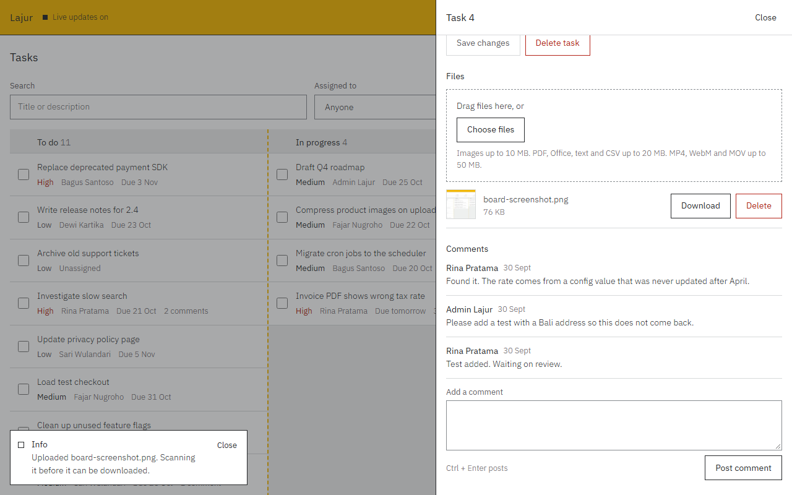
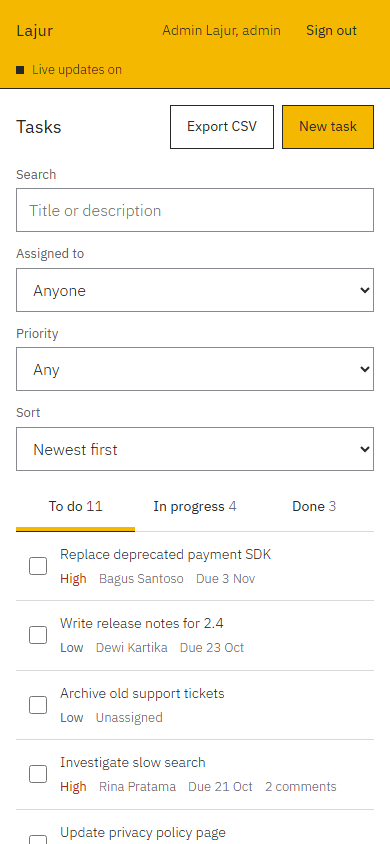

# Lajur

![PHP 8.2+][badge-php] ![Laravel 12][badge-laravel] ![MySQL 8][badge-mysql] ![Vue 3][badge-vue] ![Vite 8][badge-vite] ![Real-time: SSE][badge-sse]

A shared task board for small teams. Tasks move through three lanes (To do, In progress, Done), carry files and comments, and every change reaches the other people on the board without a reload. *Lajur* is Indonesian for "lane".

Built for the Full-Stack Developer technical assessment: Parts 1 and 2, Part 4 (without a deployment guide), and the Part 3.3 performance work.



| Sign in with a demo account | Task panel: files, comments, toasts | Phone |
|:---:|:---:|:---:|
|  |  |  |

## What it does

| Area | Details |
|---|---|
| Accounts | Email and password sign-in with JWT; logout revokes the token. Admins can change every task, members the tasks they created or are assigned to. |
| Tasks | Create, edit, delete. Status, priority, assignee, due date. Search, filter by assignee and priority, five sort orders, paging per lane. |
| Files | Drag and drop images, documents, and videos with upload progress. The type is checked from the file contents, every file is virus scanned (simulated), and images get a thumbnail. |
| Real-time | New tasks, status changes, comments, and scan results reach every open board through Server-Sent Events. |
| Background jobs | Assignment emails, bulk status changes, file processing, CSV export. |
| Phones | Below 900px wide, the lanes become tabs. |

## Quick start

Needs PHP 8.2+, Composer, MySQL 8, and Node 20+. Details are in the [setup guide](documentation/setup-guide.md).

```bash
mysql -u root -e "CREATE DATABASE lajur; CREATE DATABASE lajur_test;"

cd backend
composer install
cp .env.example .env && php artisan key:generate
php artisan migrate --seed
php artisan serve                 # terminal 1
php artisan queue:work            # terminal 2

cd ../frontend
npm install
npm run dev                       # terminal 3, open http://127.0.0.1:5173
```

## Demo accounts

| Account | Role | Password |
|---|---|---|
| `admin@lajur.test` | Admin | `password` |
| `rina`, `bagus`, `dewi`, `fajar`, `sari` (all `@lajur.test`) | Member | `password` |

> [!TIP]
> In development (`npm run dev`) the sign-in page lists these accounts. Click one to fill in the form, then sign in.

## Tests

| Suite | Command | Tests |
|---|---|---|
| Backend: PHPUnit on MySQL `lajur_test` | `cd backend && php artisan test` | 61 |
| Frontend: Vitest | `cd frontend && npm test` | 40 |
| End to end: Playwright on its own database | `cd frontend && npm run test:e2e` | 6 |

## Stack

| Layer | Choice |
|---|---|
| Backend | Laravel 12, PHP 8.2, MySQL 8, JWT (`firebase/php-jwt`), database queue |
| Frontend | Vue 3, Vite, Vue Router, Axios |
| Real-time | Server-Sent Events from a `task_events` table |
| Caching | Laravel cache (database by default, Redis optional) plus ETag and 304 |

## Documentation

| Document | Contents |
|---|---|
| [Setup guide](documentation/setup-guide.md) | Local setup, configuration, troubleshooting |
| [API reference](documentation/api-docs/openapi.yaml) | OpenAPI 3.1: every endpoint, request, and response |
| [Database schema](documentation/database-schema.md) | Tables, columns, indexes, relationships |
| [Architecture](documentation/architecture.md) | Why each piece is built the way it is, with performance measurements |
| [Requirements checklist](documentation/requirements-checklist.md) | The brief, item by item, with status |
| [Demo script](documentation/demo-script.md) | Steps and subtitles for the demo recording |
| [Design](DESIGN.md) | Palette, type, and the reason behind each UI decision |

## Repository layout

Laravel keeps application code in `backend/app` and settings in `backend/config`, so `app/` plays the role of the brief's `backend/src/`.

```
backend/                 Laravel API
  app/Http/Controllers   one controller per resource, plus the SSE stream
  app/Jobs               the four queued jobs
  app/Services           JWT, uploads, virus scanner, thumbnails, response cache
  app/Observers          write the real-time event feed, queue assignment emails
  database/              migrations, seeder, schema.sql, dump.sql
  tests/                 Unit and Feature
frontend/                Vue SPA
  src/views              sign-in page and board
  src/components         task row, panel, uploads, comments, filters, toasts
  tests/unit             Vitest
  tests/e2e              Playwright
documentation/           guides, API reference, screenshots
DESIGN.md                visual direction and the reason behind each UI decision
```

## Scope

> [!NOTE]
> Not built: chunked uploads over 50 MB, file versioning, PDF export, a deployment guide, and bonus challenges 3.1 (video streaming) and 3.2 (WebSockets, presence, typing indicators). The [requirements checklist](documentation/requirements-checklist.md) covers every item.

[badge-php]: https://img.shields.io/badge/PHP-8.2%2B-F5B800?style=flat-square&logo=php&logoColor=white&labelColor=26282A
[badge-laravel]: https://img.shields.io/badge/Laravel-12-F5B800?style=flat-square&logo=laravel&logoColor=white&labelColor=26282A
[badge-mysql]: https://img.shields.io/badge/MySQL-8-F5B800?style=flat-square&logo=mysql&logoColor=white&labelColor=26282A
[badge-vue]: https://img.shields.io/badge/Vue-3-F5B800?style=flat-square&logo=vuedotjs&logoColor=white&labelColor=26282A
[badge-vite]: https://img.shields.io/badge/Vite-8-F5B800?style=flat-square&logo=vite&logoColor=white&labelColor=26282A
[badge-sse]: https://img.shields.io/badge/Real--time-SSE-F5B800?style=flat-square&labelColor=26282A
